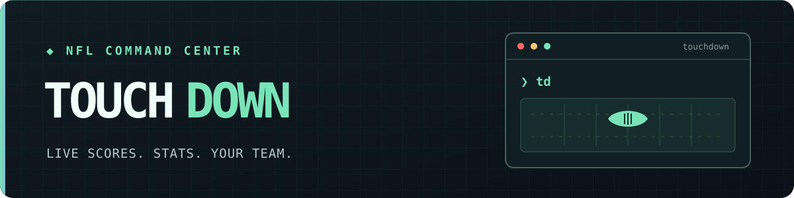
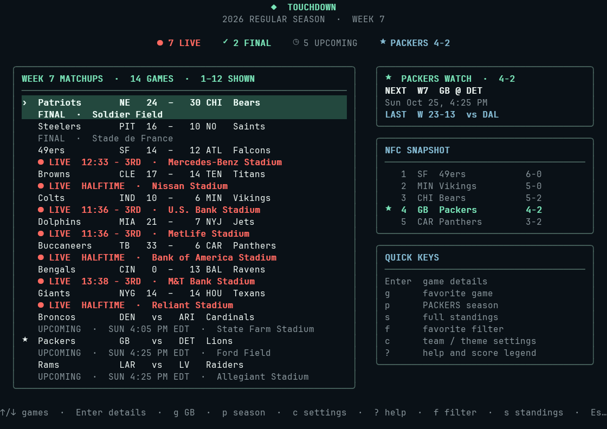
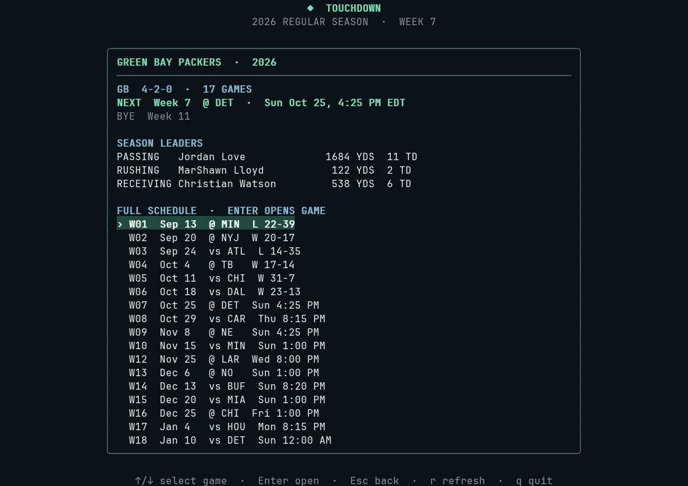
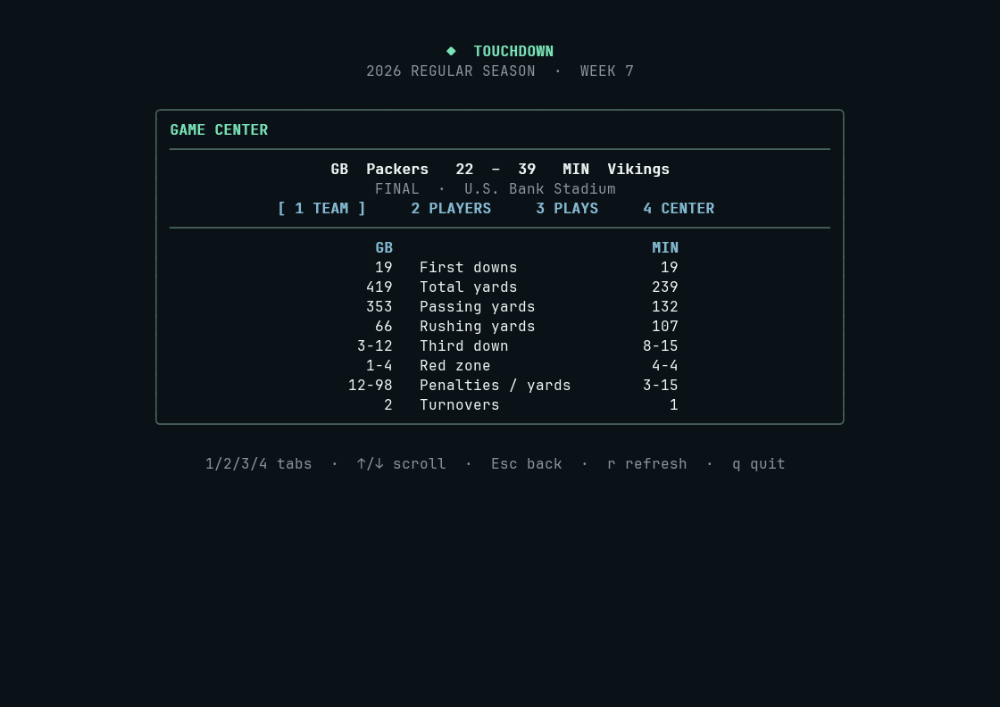

# Touchdown

**Live NFL scores and stats in your terminal.** Touchdown is a keyboard-driven dashboard built with Go, [Bubble Tea](https://github.com/charmbracelet/bubbletea), and [Lip Gloss](https://github.com/charmbracelet/lipgloss).

Follow every game, keep your favorite team in focus, and open a game for box scores, player stats, play-by-play, and scoring details. The layout adapts to smaller terminals, and recent responses remain available when you are offline.

## Features

- **Scores dashboard:** Live, final, and upcoming games with a favorite-team card and a conference standings snapshot on wide terminals.
- **Favorite-team view:** Your next matchup and kickoff, latest result, bye week, season schedule, record, and passing, rushing, and receiving leaders.
- **Game center:** Team and player stats, play-by-play, quarter scores, scoring plays, and a drive timeline. Live games show possession and the latest play when available.
- **Personalization:** Choose any NFL team and one of three themes (`mint`, `amber`, or `mono`). The favorite team also controls game filtering, standings focus, and optional score alerts.
- **Offline fallback:** Successful responses are cached locally and can be shown if a later request fails.

## Quick start

You need **Go 1.24 or later** and an internet connection for live data.

```sh
git clone https://github.com/Commanderx-code/touchdown-cli.git
cd touchdown-cli
make install
td
```

`make install` installs `touchdown` and the `td` shortcut in `~/.local/bin`. Add that directory to your `PATH` if needed. To install elsewhere, use `make install PREFIX=/your/prefix`.

To run without installing:

```sh
go run .
# or
make build
./bin/touchdown
```

Touchdown opens on a home menu. Choose all games, live games, your favorite team, its season page, or AFC/NFC standings with the arrow keys and Enter. Green Bay (`GB`) is the default favorite until you choose another team.

## Screenshots

Captured from Touchdown with Week 7 of the 2026 season selected. Scores shown here are snapshots.

[](assets/screenshots/dashboard.png)

| Favorite-team season | Game center |
| :---: | :---: |
| [](assets/screenshots/season.png) | [](assets/screenshots/game-center.png) |

## Controls

| Key | Action |
| --- | --- |
| `↑` / `↓` or `j` / `k` | Move through menus and game lists |
| `Enter` | Open the selected item or game |
| `g` | Open your favorite team's game for the displayed week; show its season page during a bye |
| `p` | Open your favorite team's season page |
| `←` / `→` or `h` / `l` | Change weeks on the dashboard, conferences in standings, or themes in settings |
| `1`–`4` or `Tab` | Switch game-detail tabs |
| `Page Up` / `Page Down` or mouse wheel | Scroll long lists |
| `s` | Open standings from the home menu or dashboard |
| `f` | Toggle the favorite-game filter on the dashboard |
| `c` | Choose a favorite team and preview a theme; `Enter` saves, `Esc` cancels |
| `r` / `?` | Refresh / show help and the score legend |
| `Esc` / `q` | Go back / quit |

The `g` and `p` keys work for every favorite team from the home menu or dashboard. In the season page, select any matchup and press Enter to inspect it; Esc returns to the same place in the schedule.

## Favorite team and theme

Set a favorite from the terminal or press `c` inside Touchdown:

```sh
td -set-favorite BUF
td -show-config
```

Settings are saved in your user config directory, usually `~/.config/touchdown/config.json`:

```json
{
  "favorite_team": "BUF",
  "theme": "amber"
}
```

Team abbreviations, nicknames, and full names are accepted without regard to case. You can also override saved settings for one launch:

```sh
td -favorite KC -theme mono
```

## Command-line options

```sh
td -once                         # Print scores once without opening the TUI
td -season 2026 -week 7          # Open a specific regular-season week
td -season 2026 -week 1 -type 3  # Open a postseason week
td -compact                      # Use the compact layout
td -notify                       # Alert for favorite-team scores and finals
td -notify-all                   # Alert for all scores and finals
```

`-type` accepts `1` for preseason, `2` for regular season (the default), and `3` for postseason. `-season` and `-week` must be used together. Use `td -h` for the full option list.

Desktop alerts are optional and require `notify-send` and a running notification service. Touchdown does not alert on an initial load or a cached response.

## Data and refresh behavior

Scores refresh every 30 seconds while Touchdown is open. The favorite-team schedule loads in the background and refreshes every five minutes. Season leader totals are calculated from completed game box scores when you open the season page; they may be partial if a game summary is unavailable.

Touchdown uses ESPN's publicly accessible, undocumented NFL scoreboard, summary, schedule, and standings endpoints. Those endpoints can change or become unavailable. Data can lag live action, and stats or play-by-play may be absent before kickoff or while a game is being updated. Kickoff times use your terminal's local timezone.

Successful responses are saved in your user cache directory, usually `~/.cache/touchdown`. If a request fails, Touchdown can display the last saved response and mark cached scores as `CACHED`. Cached data may be old; use `r` to retry when you are back online.

## Development

```sh
make test
go vet ./...
```

Touchdown is an original Go implementation inspired by [kickoff-cli](https://github.com/e12jassir/kickoff-cli).
